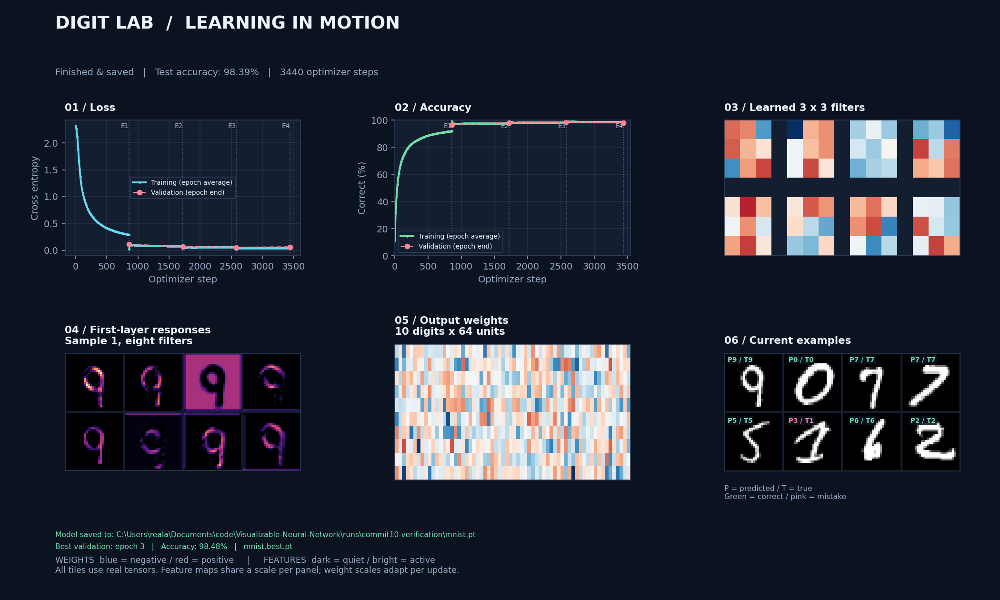
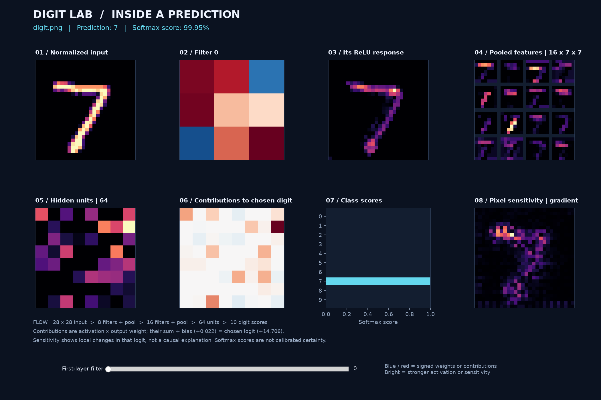

# Digit Lab: Visualizable Neural Network

A small PyTorch CNN with two separate workflows: watch it learn handwritten digits,
then inspect how it processes an image of your own. The views display actual model
tensors at a high level without rendering thousands of connections every batch.




## Setup

Use Python 3.11 or 3.12 with a desktop GUI. In the repository directory:

```sh
python -m venv .venv
# Windows PowerShell:
.venv\Scripts\Activate.ps1
# macOS / Linux: source .venv/bin/activate
python -m pip install -r requirements.txt
```

For a smaller CPU-only installation, install PyTorch first:

```sh
python -m pip install torch torchvision --index-url https://download.pytorch.org/whl/cpu
python -m pip install -r requirements.txt
```

For GPU builds, use the appropriate installation command from
[PyTorch](https://pytorch.org/get-started/locally/). The app selects CUDA, MPS, or CPU
automatically; `--device cpu` overrides this. Linux desktop users may need their
distribution's `python3-tk` package. A notebook's inline plotting backend does not
provide the live desktop window; run the commands in a terminal.

## 1. Train with live visualization

```sh
python train.py
```

MNIST downloads on the first run. The dashboard includes:

- Training loss and accuracy, accumulated within the current epoch.
- Validation loss and accuracy at each completed epoch (coral dashed lines).
  Dotted lines labeled E1, E2, etc. mark epoch ends; gaps in the training curves
  show where the running averages reset. Validation progress appears in the status line.
- All eight learned first-layer kernels, with blue negative and red positive weights.
- First-layer feature maps for the first displayed image.
- The full 10-by-64 output weight matrix.
- Up to eight images with predicted and true labels.
- **Pause / Resume** and **Stop & save** controls. Closing the window also stops
  training and saves current weights after finishing the current batch.
  After stopping or completing training, the window confirms where the model
  was saved, disables Pause, and changes **Stop & save** to **Close**.

The architecture is `1x28x28 -> Conv(8) -> ReLU -> Pool -> Conv(16) -> ReLU -> Pool
-> Linear(64) -> ReLU -> Linear(10)`: **52,138 parameters**. There is no dropout,
so the displayed forward pass matches training behavior without stochastic masks.

Defaults: four epochs, batches of 64, Adam at 0.001, two CPU threads, and at most
one dashboard redraw per second. Event handling runs between batches. Increase
the redraw interval or limit samples for slower machines:

```sh
python train.py --epochs 2 --max-train-samples 10000 --viz-seconds 2
```

Training uses a seeded 55,000 / 5,000 training/validation split. Validation runs
after each completed epoch. The separate 10,000-image test set is evaluated at
the end. `--max-eval-samples 500` limits both evaluation sets for quick checks;
results from that setting are subset results. No particular accuracy is guaranteed.

Outputs (relative to the source directory by default):

- `runs/<run-name>/mnist.pt`: current weights, architecture version and training metadata.
- `runs/<run-name>/mnist.best.pt`: weights from the epoch with the highest validation
  accuracy in this run (the earliest epoch wins ties).
- `runs/<run-name>/metrics.json`: epoch history, final test metrics and interruption status.
- `runs/<run-name>/training.png`: final dashboard snapshot.
- `runs/<run-name>/run.json`: run summary and checkpoint locations for model selection.

Checkpoints are written atomically each completed epoch and again at the end,
including a normal stop or Ctrl+C during training. They support prediction, not
optimizer-state resume. Each training run creates a fresh model in a unique folder
named with a timestamp and random suffix. The console prints its location.
Use `--run-dir runs/my-experiment` to name a run. Existing result folders and
checkpoint files are rejected so an experiment cannot silently overwrite another.
`--checkpoint` can still specify a new checkpoint path outside the run folder.
A stop before the first optimizer step does not save an untrained checkpoint.

The dashboard and console report the best validation epoch and accuracy. The
`best` entry in metrics and checkpoint metadata records its epoch, validation
metrics, and file path. With `--checkpoint path/model.pt`, the best model is
saved beside it as `path/model.best.pt`. Best weights are saved immediately on
improvement and survive a later stop. No best model is selected until a full
validation pass completes; files from older runs are left untouched until a new
best model is saved. Use separate checkpoint paths to preserve experiments.

The final test accuracy describes the **latest** weights, and never determines
which model is best. To inspect an image with the best validation model:

```sh
python predict.py examples/digit.png --run latest --weights best
```

For a server or headless run:

```sh
python train.py --no-ui --epochs 2
```

## 2. Inspect an image

```sh
python predict.py "path/to/digit.png"
# Included MNIST example:
python predict.py examples/digit.png
# Or open a file picker:
python predict.py
# List saved runs and their best validation results:
python predict.py --list-runs
# Select a run by the name printed in that list:
python predict.py examples/digit.png --run YOUR_RUN_NAME --weights best
```

Use an image containing **one handwritten digit, 0 through 9** with a plain,
contrasting background and space around the digit. This is an MNIST classifier;
it does not recognize general objects, words, or multiple digits. Prediction runs
entirely from the checkpoint and does not download MNIST.

Prediction defaults to the latest saved run's latest weights. `--weights best`
selects that run's best validation checkpoint; it reports an error if validation
never completed. Use `--runs-dir path/to/runs` to list or select runs elsewhere.
`--checkpoint path/to/model.pt` loads older or standalone models directly and
cannot be combined with `--run`. With no saved runs, the legacy
`checkpoints/mnist.pt` is still used if it exists. Runs made before run summaries
were introduced remain accessible through `--checkpoint`. Listing skips unreadable
summaries and runs whose latest checkpoint is missing. Keep run folders in place:
their summaries record absolute checkpoint paths.

The loader applies EXIF orientation, composites transparency onto white, detects
ink polarity from the border, crops the foreground, fits it into 20 by 20 pixels,
and centers its mass in a 28 by 28 canvas. Then it applies the same `[-1, 1]`
normalization used in training. Check the normalized input panel if results look
unexpected. For unusual backgrounds, specify `--polarity dark` or `--polarity light`
to describe the **ink** color. Photos with shadows or clutter need cleanup first.

The inspector shows the processed input, a selectable first-layer kernel and its
actual ReLU response, all 16 pooled second-layer feature maps, 64 hidden
activations, signed contributions to the predicted digit, ten softmax scores,
and input-gradient sensitivity. Drag the filter slider to inspect all eight kernels.
Click **Open image** to inspect another digit in the same window with the same
loaded model and selected filter. Cancelling keeps the current prediction;
invalid images display an error while leaving the previous result available.
The `--polarity` setting also applies to images opened with this button.
`--output` saves the initial inspection; use the window's Save toolbar control
to export a later image's inspection.

**Reading the views:** a feature map shows where a learned filter responds.
Contributions are exactly `hidden activation * chosen output weight`; their sum
plus the output bias reconstructs that digit's raw score (logit). Sensitivity is
the absolute gradient of that score with respect to input pixels. It describes
local sensitivity, not a causal explanation. Softmax scores are not calibrated
probabilities of correctness, especially for inputs unlike MNIST. Color scales
adapt per panel/update, so compare signs and structure rather than brightness
across different training frames. Weight colors preserve zero and sign.

Save a dashboard, including without a desktop:

```sh
python predict.py digit.png --output runs/prediction.png
python predict.py digit.png --no-ui --output runs/prediction.png
```

`python main.py train ...` and `python main.py predict ...` are equivalent entry
points. Run `python train.py --help` or `python predict.py --help` for all options.

## Code layout and checks

See the [improvement roadmap](docs/roadmap.md) for the next ten focused changes.

| File | Purpose |
| --- | --- |
| `model.py` | CNN, traced forward pass, device selection, checkpoint format |
| `train.py` | Data split, optimization, evaluation, stopping and saving |
| `predict.py` | Image selection and inference command |
| `images.py` | Preprocessing, activations, contributions, gradients |
| `dashboard.py` | Persistent plot artists and interactive controls |
| `test_core.py` | Forward tracing, weight updates, checkpoint and image tests |
| `test_dashboard.py` | Headless rendering, small batches, filter slider |
| `test_train.py` | Completed and interrupted training checkpoint checks |
| `runs.py`, `test_runs.py` | Run summaries, preservation, and model selection |

```sh
python -m unittest discover -v
```

Only sampled images are copied for visualization, the plotted history is bounded
to about 1,000 points, and no autograd graph is retained between display updates.
Inference computes one forward pass and one input-gradient pass. Checkpoints use
the restricted `weights_only=True` loader; load checkpoints from trusted sources.
Old checkpoints from a different architecture are not compatible.

Reference: [PyTorch model saving/loading](https://docs.pytorch.org/tutorials/beginner/saving_loading_models.html)
and [Matplotlib widgets](https://matplotlib.org/stable/api/widgets_api.html).

## License

Free to use for educational purposes, consistent with the original project notice.
